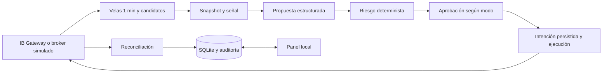

# Options Desk

Aplicación local de análisis y ejecución de opciones estadounidenses mediante la TWS API oficial de Interactive Brokers. Python 3.11+, `asyncio`, SQLite, OpenAI Responses API y Streamlit. Arranca en `OBSERVE`. El broker simulado y el replay funcionan sin cuenta, credenciales ni servicios externos.

Los límites son controles técnicos para desarrollo. La señal de momentum y los resultados simulados no demuestran una ventaja económica ni garantizan ganancias. El sistema no evita todos los riesgos de mercado, ejecución, ejercicio o vencimiento.

## Arquitectura



La IA recibe únicamente un snapshot normalizado. No recibe claves ni identificadores de cuenta. No posee herramientas, acceso web ni acceso al broker. Solo propone un `candidate_id` suministrado en esa decisión. El motor valida esquema, referencias, contrato, cotización y riesgo. `HOLD` es un resultado normal y jamás crea una orden.

| Archivo | Responsabilidad |
| --- | --- |
| `app/config.py`, `app/models.py` | Configuración acotada y modelos Pydantic con campos extra prohibidos |
| `app/store.py` | Migración numerada, transacciones, idempotencia, controles y auditoría |
| `app/broker.py` | Contrato común y broker simulado |
| `app/ibkr.py` | Adaptador oficial de IB Gateway |
| `app/market.py` | Velas UTC, señales y filtrado de candidatos |
| `app/analyst.py` | Responses API y analista determinista de simulación |
| `app/risk.py` | Límites y autorización determinista |
| `app/engine.py` | Orquestación, órdenes, aprobación y reconciliación |
| `app/replay.py` | Reproducción determinista de fixtures |
| `app/doctor.py`, `app/ui.py` | Diagnóstico y panel |
| `tests/` | Pruebas `unittest` y escenarios JSONL |

## Instalación local

Ejecuta desde la raíz del proyecto:

```bash
python3 -m venv .venv
.venv/bin/python -m pip install -r requirements.txt
.venv/bin/python -m app init-db
.venv/bin/python -m app doctor
```

Las dependencias directas son `openai`, `pydantic`, `streamlit` y `pandas`. Sus dependencias transitivas se instalan mediante pip. El SDK oficial `ibapi` se distribuye por Interactive Brokers y es opcional para simulación. No instales un paquete de terceros con un nombre parecido para reemplazarlo. `python -m pip check` verifica compatibilidad de paquetes instalados; no equivale a una auditoría de vulnerabilidades.

El cliente oficial se obtiene en [API Software de Interactive Brokers](https://interactivebrokers.github.io/). Las [instrucciones de instalación de la TWS API](https://www.interactivebrokers.com/docs/tws-api/doc/download-the-tws-api/install-the-tws-api-on-mac-os-linux) deben corresponder a la versión descargada. Esta instalación usa la distribución oficial 10.50.02 (`ibapi==10.50.2`) con su dependencia `protobuf==5.29.5`. El archivo descargado es [twsapi_macunix.1050.02.zip](https://interactivebrokers.github.io/downloads/twsapi_macunix.1050.02.zip), SHA256 `673129e5cba58c4d77bc40647265f84ea42f605eccf88fa4c1221d62d12454f3`. El SDK descargado se conserva en `work/tws-sdk/IBJts/source/pythonclient` y se puede reinstalar así:

```bash
.venv/bin/python -m pip install ./work/tws-sdk/IBJts/source/pythonclient
```

Para una instalación nueva descarga y extrae la misma distribución oficial antes de ejecutar ese comando. IB Gateway es un programa separado y no se instala con este proyecto.

## Inicio rápido sin servicios externos

En una terminal:

```bash
.venv/bin/python -m app run --broker fake
```

En otra terminal:

```bash
.venv/bin/streamlit run app/ui.py --server.address 127.0.0.1 --server.port 8501
```

Abre [el panel local](http://127.0.0.1:8501). El motor comienza en `OBSERVE`. En Controles solicita `PAPER_APPROVAL` para revisar cada propuesta o `PAPER_AUTO` para ejecutar simulaciones automáticas. El broker fake utiliza un analista determinista y no llama a OpenAI. Cambiar el modo no crea una operación por sí mismo: debe existir una señal válida, una propuesta vigente y riesgo permitido.

El motor y el panel deben compartir `APP_DB`. El panel no arranca el motor y los comandos normales quedan en cola hasta que el motor los procesa. Pausar, desarmar y activar el kill switch escriben el bloqueo inmediatamente. El panel se actualiza cada tres segundos. Mantén el servidor en loopback: no incorpora autenticación para exposición a internet.

Para una ejecución local limitada:

```bash
.venv/bin/python -m app run --broker fake --max-seconds 30
```

## Variables de entorno y secretos

`.env.example` contiene solamente nombres y valores de ejemplo. `.env` está excluido de Git. La aplicación lee el entorno del proceso; no carga `.env` automáticamente. Exporta los valores de forma deliberada antes de iniciar el proceso. No pegues credenciales en el panel, JSON, fixtures, comandos de diagnóstico ni SQLite.

| Variable | Valor predeterminado / propósito |
| --- | --- |
| `OPENAI_API_KEY` | Ausente; sin ella el analista devuelve `HOLD` |
| `OPENAI_MODEL` | `gpt-6-astra`; permite cambiar el modelo sin editar código |
| `IBKR_ENV` | `paper`; debe coincidir con el tipo de cuenta |
| `IBKR_ACCOUNT` | Cuenta exacta seleccionada para la conexión real |
| `IBKR_HOST` | `127.0.0.1`; solo se permite loopback |
| `IBKR_PORT` | `4002`; debe coincidir con el puerto configurado en Gateway |
| `IBKR_CLIENT_ID` | `17`; usa un identificador reservado para este motor |
| `LIVE_TRADING_ENABLED` | `false`; nunca basta por sí sola para habilitar Live |
| `APP_DB` | `data/app.sqlite3`; ruta alternativa para separar experimentos |

OpenAI usa Responses API con `reasoning.effort=medium`, salida breve y esquema JSON estricto. Todos los campos de propuesta son obligatorios y los opcionales admiten `null`. Pydantic vuelve a validar el resultado. Error, timeout, rechazo, respuesta incompleta o JSON inválido producen `HOLD`. El SDK no reintenta las decisiones automáticamente. La disponibilidad real de `gpt-6-astra` depende de la cuenta y debe verificarse externamente; el código no sustituye silenciosamente el modelo. Consulta [Responses API](https://developers.openai.com/api/reference/resources/responses/methods/create) y [Structured Outputs](https://developers.openai.com/api/docs/guides/structured-outputs).

## Configuración no secreta

`Config` tiene valores predeterminados utilizables. Un archivo opcional `config.json` en la raíz puede sobrescribirlos. El panel envía cambios completos validados y el motor guarda la configuración en SQLite con auditoría. `OPENAI_MODEL` y los parámetros de conexión del entorno se aplican al cargar la configuración de arranque.

Ejemplo de `config.json`:

```json
{
  "mode": "OBSERVE",
  "symbols": ["AAPL", "MSFT"],
  "risk_capital": 10000,
  "max_trade_risk_pct": 0.005,
  "max_daily_loss_pct": 0.01,
  "max_openings_per_day": 3,
  "min_dte": 21,
  "max_dte": 60,
  "max_spread_pct": 0.15,
  "max_data_age_seconds": 30,
  "cooldown_minutes": 15,
  "decision_minutes": 5,
  "commission_per_contract": 0.65,
  "slippage": 0.01
}
```

Los porcentajes del archivo son fracciones: `0.005` significa 0.5 %. En el panel se muestran como porcentajes. El intervalo completo admite divisores de 60 desde cinco minutos. Las velas siguen siendo de un minuto. El spread se mide como `(ask - bid) / mid`. Slippage es precio por unidad de opción y las comisiones son USD por contrato. La señal requiere seis cierres consecutivos para medir el cambio de cinco minutos. Un hueco de datos no se rellena inventando precios.

Las barreras de configuración incluyen máximo un contrato, máximo tres aperturas diarias, cooldown mínimo de quince minutos, riesgo por operación máximo del 1 %, pérdida diaria máxima del 2 %, DTE mínimo de un día y rechazo permanente de 0DTE. La configuración inicial es más conservadora: DTE 21–60 y riesgos 0.5 %/1 %. La primera versión solo acepta contratos estándar USD con multiplicador 100 y exchange SMART.

## IB Gateway y cuenta Paper

Esta sección requiere una instalación y una sesión de IB Gateway autorizadas por el usuario. Ningún paso del proyecto entra en una cuenta mediante navegador ni automatiza clics.

1. Descarga e instala IB Gateway desde IBKR cuando decidas habilitar el servicio externo
2. Inicia sesión manualmente en Paper y selecciona la cuenta de simulación
3. En los ajustes API comprueba conexiones de socket, acceso local, puerto y client ID; conserva acceso solo desde localhost
4. Mantén inicialmente la API en modo de solo lectura mientras verificas cuenta, posiciones y datos; para ejecutar Paper tendrás que habilitar deliberadamente los envíos API
5. Configura `IBKR_ENV=paper`, `IBKR_ACCOUNT` y el puerto real de tu sesión. El puerto predeterminado de este proyecto es 4002; un puerto por sí solo no demuestra el tipo de cuenta
6. Ejecuta el diagnóstico externo solo después de autorizar el acceso y luego inicia el motor con `--broker ibkr` en `OBSERVE`
7. Comprueba en el panel cuenta, entorno, datos actuales, reconciliación y ausencia de alertas críticas antes de seleccionar un modo Paper

```bash
.venv/bin/python -m app doctor --probe-external
.venv/bin/python -m app run --broker ibkr
```

Las suscripciones deben cubrir datos API de las acciones elegidas y sus opciones estadounidenses. OPRA es el conjunto habitual para opciones estadounidenses y los datos del subyacente dependen de sus mercados. Los permisos visibles en la web no prueban acceso API. IBKR controla permisos, suscripciones, capacidad de líneas y reglas de compartición entre Paper y Live. El proyecto no compra datos ni supone que una cotización retrasada es actual. Sin bid/ask actual o sin volumen/open interest utilizable no abre operaciones. Verifica las condiciones vigentes en [la documentación oficial de datos de mercado](https://www.interactivebrokers.com/docs/tws-api/doc/introduction).

## Modos y controles

| Modo | Comportamiento |
| --- | --- |
| `OBSERVE` | Recoge y evalúa datos; no envía órdenes |
| `PAPER_APPROVAL` | Paper o fake; aprobación humana de cada propuesta vigente |
| `PAPER_AUTO` | Paper o fake; ejecución tras validar riesgo |
| `LIVE_APPROVAL` | Cuenta Live; aprobación por propuesta y barreras Live completas |
| `LIVE_AUTO` | Cuenta Live; automatización sujeta a las mismas barreras Live |

El panel muestra estado, cuenta, próximo ciclo, decisión, límites, velas, candidatos, propuestas, órdenes, fills, posiciones, PnL, métricas IA y auditoría. No acepta SQL, comandos del sistema ni secretos. Aprobar nunca evita la revalidación final de contrato y cotización. Cancelar solicita cancelación y espera reconciliación: una ejecución simultánea puede ganar esa carrera.

El kill switch es persistente y bloquea aperturas. No es un botón de liquidación. Una orden ya aceptada por el broker puede ejecutarse antes de que llegue una cancelación. Pausar impide envíos; desarmar vuelve a `OBSERVE`. Retirar el kill switch requiere una confirmación explícita en el panel y no convierte por sí solo el modo en automático.

## Riesgo y recuperación

El motor rechaza contratos desconocidos, cantidad mayor a uno, opciones cortas, spreads, órdenes de mercado, 0DTE, datos incompletos/no finitos/viejos, bid cero, spread amplio, liquidez ausente, cuentas o entornos incorrectos, alertas críticas, desconexión, efectivo insuficiente, exceso de riesgo, pérdidas diarias, aperturas duplicadas y posiciones repetidas por subyacente. `SELL_TO_CLOSE` exige una posición larga real suficiente. La pérdida diaria incluye el PnL disponible del broker. El conteo diario utiliza la fecha de Nueva York. Se cuentan conservadoramente las intenciones de apertura duraderas aunque su resultado sea incierto.

La clave idempotente incluye cuenta, modo, símbolo, cierre de vela y estrategia. SQLite confirma propuesta, riesgo e intención antes del envío. Tras reiniciar se consultan posiciones, órdenes y ejecuciones del broker. Una intención de resultado incierto no se reenvía a ciegas. Las discrepancias generan alertas y bloquean nuevas aperturas. Los fills tienen identificadores únicos y las actualizaciones tardías no hacen retroceder una orden completamente ejecutada.

Un bloqueo de archivo por base de datos impide dos motores simultáneos. Usa una DB por motor y no inicies otra instancia contra la misma cuenta para eludir esta barrera. No borres archivos `.lock`, órdenes o claves idempotentes para forzar reenvíos. Ante una discrepancia: pausa, conserva la DB, revisa el estado en Gateway y los eventos, vuelve a conectar y deja que el motor reconcilie. Si persiste una alerta crítica hay que resolver la causa antes de continuar. El kill switch se conserva tras reiniciar; la autorización temporal Live no.

## Replay y pruebas

```bash
.venv/bin/python -m unittest discover -s tests -v
.venv/bin/python -m app replay tests/fixtures/normal.jsonl --db data/replay-a.sqlite3
.venv/bin/python -m app replay tests/fixtures/normal.jsonl --db data/replay-b.sqlite3
.venv/bin/python -m pip check
```

Usa bases de datos nuevas para comparar ejecuciones independientes y no mezclar auditoría. Repetir un ciclo contra una base existente conserva la idempotencia y no debe crear otra orden. Los fixtures cubren mercado normal, spread amplio, datos viejos, ausencia de señal, contrato inválido, desconexión, fill parcial, duplicados y pérdida diaria. La prueba end-to-end cubre apertura, fill, posición, cierre y auditoría sin servicios externos.

El replay usa tiempos y propuestas deterministas. Considera bid/ask, límite, comisión, slippage, vencimiento y ausencia de liquidez. Los resultados sirven para verificar comportamiento técnico. No modelan fielmente una cola de órdenes real, profundidad completa, impacto de mercado o prioridad de ejecución. Ningún PnL simulado debe interpretarse como rentabilidad esperada.

## Doctor

```bash
.venv/bin/python -m app doctor
```

El diagnóstico distingue `Listo`, `Advertencia` y `Bloqueado`. Revisa Python, dependencias, configuración, SQLite, bloqueo de proceso, presencia de variables sin valores, barreras Live, kill switch, cuenta y frescura observadas. Por defecto no lee ninguna cuenta externa ni consulta OpenAI o Gateway. Una instalación sin credenciales puede estar lista para simulación y mostrar advertencias para servicios externos.

`--probe-external` es una acción explícita de lectura externa: consulta acceso al modelo de OpenAI y conectividad local de Gateway. La prueba de puerto por sí sola no demuestra autenticación, cuenta, suscripciones ni capacidad de ejecutar. El panel y el diagnóstico distinguen datos simulados de los recibidos del adaptador real.

## Habilitación futura de Live

Live no se habilita durante la construcción ni la verificación local. Antes de un uso futuro se necesita autorización del titular y validación prolongada en Paper. Las condiciones simultáneas son `IBKR_ENV=live`, `LIVE_TRADING_ENABLED=true`, cuenta conectada identificada como Live, motor reconciliado y sano, datos actuales, ninguna alerta crítica y confirmación escrita `ENABLE LIVE <cuenta>` desde la sesión actual del panel para la sesión actual del motor. La confirmación expira; no se guarda como autorización permanente.

Usa inicialmente `LIVE_APPROVAL`. Revisa los límites de nuevo, las suscripciones, el efectivo, las posiciones ya existentes y las órdenes pendientes. Reiniciar el motor invalida la confirmación previa. Cambiar el modelo o modificar un JSON nunca habilita estas barreras. La aplicación no incluye cierre automático de todas las posiciones.

## Límites conocidos y verificación pendiente

- El broker fake y el analista determinista prueban la mecánica del sistema. No validan ejecución real, precisión de cotizaciones ni calidad de decisiones de OpenAI
- Paper usa dinero simulado y sus fills pueden diferir del mercado real. Live usa dinero real y añade riesgo de liquidez, coste, deslizamiento, fallos y ejercicio
- La estrategia inicial es momentum simple con lista blanca pequeña. No es una estrategia validada estadísticamente ni cubre noticias, resultados, dividendos o cambios corporativos
- Solo se soportan opciones largas estándar de acciones USD, cuenta individual y órdenes límite de un contrato. No hay spreads, opciones desnudas, Forex, asignación de cuentas ni ejercicio automático gestionado
- El proceso necesita IB Gateway autenticado y datos autorizados. Reinicios de Gateway, autenticación y permisos siguen siendo responsabilidades operativas externas
- El panel local no sustituye la observación de órdenes y posiciones en el broker. Un fallo de red no revierte una orden ya recibida
- La versión instalada del SDK debe ser compatible con Gateway. La instalación del SDK no demuestra una conexión exitosa
- Sin credenciales y servicio externo autorizados quedan pendientes la conexión autenticada a OpenAI/IBKR, el tipo real de cuenta, las suscripciones y cualquier ejecución Paper real

Los resultados concretos de pruebas, replay y verificación visual corresponden al informe de ejecución entregado con el proyecto. Este README documenta capacidades y procedimientos; no afirma que se hayan usado servicios externos.
